# Koudai-oh Animation

Koudai-oh の状態を 8bit 風ドット絵アニメーション（5fps）で表示する。
ブラウザで開けば動く。ビルドもサーバも不要。

- `dist/koudaioh.html` … 羽なし版。1 ファイルでどこに置いても動く（ロボットへのコピー、アプリのプレビューなど）
- `dist/koudaioh_wings.html` … 羽付き版。椅子の上に浮いて羽ばたく。これも 1 ファイル
- `web/index.html` … 開発用。同じフォルダの `.js` を読み込むので、`web/` フォルダごと開く（`?wings=1` で羽付き）

| 羽なし | 羽付き |
|---|---|
| 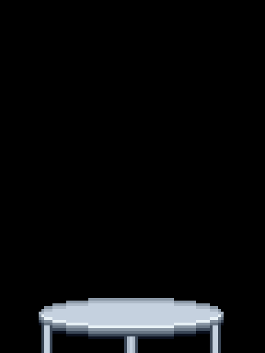 | 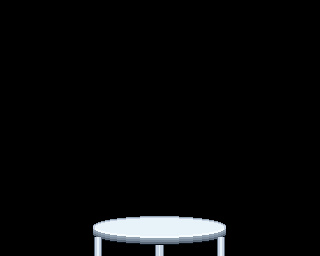 |

## 動かし方

```
dist/koudaioh.html（羽なし）か dist/koudaioh_wings.html（羽付き）をブラウザで開く（file:// のままでよい）
```

`KoudaiohAnim is not defined` と出る場合は、`web/index.html` を単体で開いていて隣の `.js` が読めていない。
`dist/` の 1 ファイル版を使うか、`web/` フォルダごと開く。

| キー | ボタン | 内容 |
|---|---|---|
| `1` | 平時 | ① アイドリング |
| `2` | CAN通信死 | ② 内部ハードウェアエラー |
| `3` | 自動運転 | ③ AUTO MODE |
| `4` / `Space` | 発射 | ④ 発射（単発。終わると元の状態に戻る） |
| `5` | 通信切断 | ⑤ スマホとの NO LINK |
| `6` | 登場 | 画面外から椅子に飛び乗る（右から / 左から）。羽付き版は飛んで来る |
| `7` | 退場 | 椅子から画面外へ飛び降りる（左へ / 右へ）。羽付き版は飛び去る |
| `H` | — | 操作パネルの表示切替 |
| — | 羽付き版にする / 羽なし版にする | 版の切り替え（羽のデータが入っているページだけ） |

### URL パラメータ

| 例 | 内容 |
|---|---|
| `?state=auto` | 初期状態（`idle` / `can_dead` / `auto` / `no_link`） |
| `?present=0` | 椅子に誰もいない状態から始める（登場で乗る） |
| `?ui=0` | 操作パネルを隠し、画面いっぱいに表示（ロボット搭載ディスプレイ用） |
| `?scale=4` | 拡大率。省略時は画面に収まる最大の整数倍 |
| `?fps=5` | コマ速度 |
| `?can=slump` | CAN 通信死を「ガクッと下がって静止」にする（既定は振動） |
| `?ws=ws://192.168.0.10:8080/` | コマンドを受け取る WebSocket の接続先（切れたら 2 秒ごとに再接続） |
| `?seed=1` | 乱数シード（スパークの出方を固定） |
| `?wings=1` / `?wings=0` | 羽付き版 / 羽なし版（既定は `dist/koudaioh_wings.html` だけ羽付き） |

### 外部から状態を切り替える（WebSocket）

`?ws=` を付けると、ページが WebSocket クライアントとして接続し、受け取ったコマンドで状態を切り替える。

受信（どちらの形式でもよい）:

```
auto
fire
enter left
{"cmd": "exit", "arg": "right"}
{"state": "no_link"}
```

送信（状態が変わるたびにページから送る）:

```json
{"event": "state", "state": "auto"}
{"event": "action_start", "action": "fire"}
{"event": "action_end", "action": "fire"}
```

### JavaScript から

```js
const anim = new KoudaiohAnim.Animator(KOUDAIOH_SPRITE, { state: 'idle', seed: 1 });
// 羽付き版: new KoudaiohAnim.Animator(KOUDAIOH_SPRITE, { wings: KOUDAIOH_WINGS })
anim.setState('auto');   // 持続状態: idle / can_dead / auto / no_link
anim.fire();             // 単発。椅子に乗っていて、他の動作中でなければ true
anim.exit('left');       // 乗っているときだけ
anim.enter('right');     // 不在のときだけ
anim.command('enter', 'left');   // 文字列でも同じ
const raster = anim.step();      // 1 コマ描いて進める。raster.data は 192x256（羽付き版は 320x256）の RGBA
```

`web/index.html` では `window.koudaioh.command('fire')` で同じことができる。

動作中（発射・登場・退場）に `setState` すると、動作が終わった後にその状態になる。
動作中の別の動作は無視される（`false` が返る）。

## モーション

5fps（1 コマ 200ms）。解像度は元の 8bit 絵のドット格子そのままの 192×256 で、表示時に整数倍で拡大する。
動きとエフェクトの寸法は 1 unit = 2px で書いてある（「1 ピクセル上げる」は 1 unit）。

| | 本体 | 目 | エフェクト | ループ |
|---|---|---|---|---|
| ① 平時 | 1 unit 上げ下げ | 少し暗く → パッと明るく | — | 5 コマ |
| ② CAN 通信死 | 毎コマ上下左右に 1 unit ランダム（`slump` なら 1 unit 沈んで静止） | 毎コマ点滅、赤 / 黄 / 紫にランダム変色、黒いノイズ線 | 黄・青のスパーク、行ずれグリッチ | ランダム |
| ③ 自動運転 | 2 コマ周期で上下 | 光のラインが左右に往復 | 額マークが青 / 緑に点滅、頭上に `AUTO`、頭から広がるレーダー波 | 10 コマ |
| ④ 発射 | 1 unit 沈む → 2 unit 跳ね上がる → 揺れ 2 コマ → 復帰 | 溜めで白く強く発光 | 胸からマズルフラッシュ、衝撃波リング、煙 | 5 コマ単発 |
| ⑤ 通信切断 | 10 コマに 1 回だけゆっくり上下 | 消灯（バイザーの黒） | 頭上に `?` とアンテナ × がふわふわ、画面全体を減光 | 10 コマ |
| 登場 | 画面下（床）から放物線で椅子に飛び乗る → 着地で 2 unit 沈む | 一度暗くしてからパッと点灯 | 残像、着地の土煙 | 9 コマ単発 |
| 退場 | 屈んで溜める → 放物線で画面下へ飛び降りる | 溜めで明るく | 残像、踏み切りの土煙 | 7 コマ単発 |

| | |
|---|---|
| ① 平時 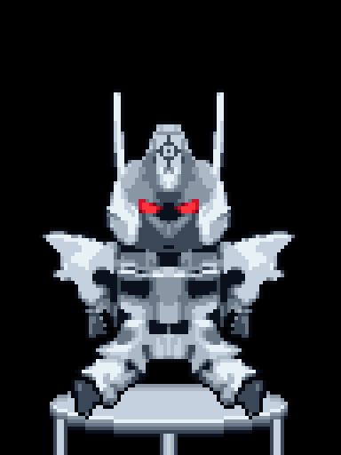 | ② CAN 通信死 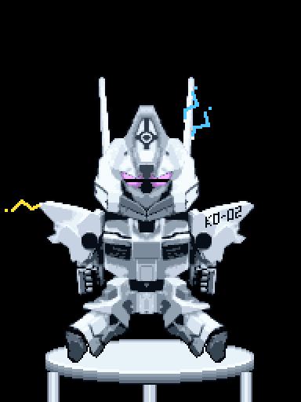 |
| ③ 自動運転 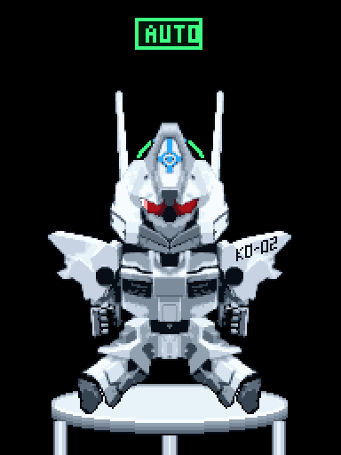 | ④ 発射  |
| ⑤ 通信切断 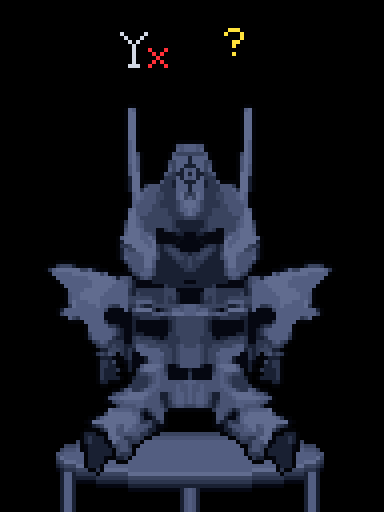 | 登場・退場 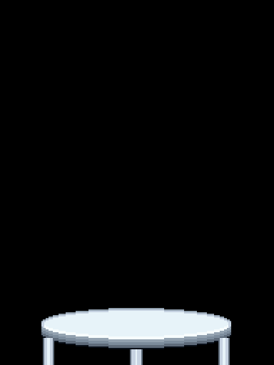 |

コマ割りは `docs/preview/*_sheet.png`（全コマを横に並べたもの）で確認できる。

### 羽付き版

足（座った姿勢）はそのままで、本体ごと椅子の上に 12 unit（24px）浮き、羽ばたきに合わせてぷかぷか上下する。
羽は `assets/source/koudaioh_wings_sheet.png` の 5 コマ（01 上げ → 05 下げ）。打ち下ろしで体が持ち上がり、打ち上げで少し沈む。
座面には浮いた高さに応じた影が落ちる。目・額マーク・エフェクト・HUD は羽なし版と同じ。

| | 羽ばたき（羽のコマ） | 浮き方 |
|---|---|---|
| ① 平時 | 01→05→01 の往復、8 コマ | 打ち下ろしで 1 unit 上がり、打ち上げで 1 unit 沈む |
| ② CAN 通信死 | 毎コマランダム（痙攣） | 浮いたまま振動。`slump` なら椅子に落ちて羽はだらりと下がる（05） |
| ③ 自動運転 | 01→03→05→03、4 コマ（速い） | 速く上下 |
| ④ 発射 | 溜めで上げ → 発射で広げ → 反動で打ち下ろす | 浮いた位置から反動 |
| ⑤ 通信切断 | 04〜05 で下げ気味のまま | 低く（5 unit）浮き、10 コマに 1 回だけ動く |
| 登場 | 速く羽ばたく | 画面右上（または左上）から斜めに降りてきて浮く位置で止まる |
| 退場 | 溜めて強く打ち下ろす | 沈んでから上昇し、斜め上へ飛び去る |

| | |
|---|---|
| ① 平時 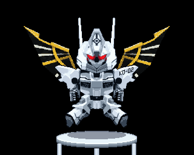 | ② CAN 通信死 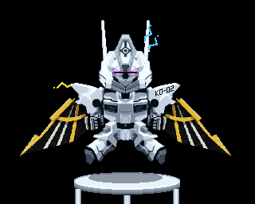 |
| ③ 自動運転 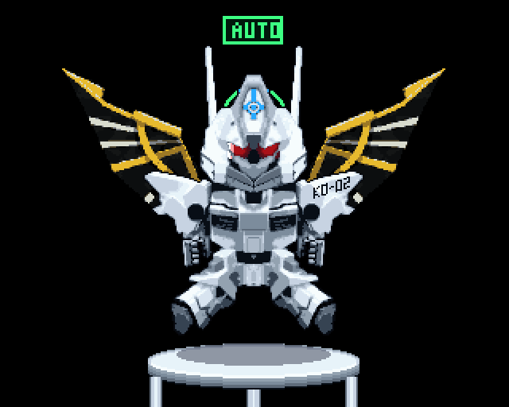 | ④ 発射 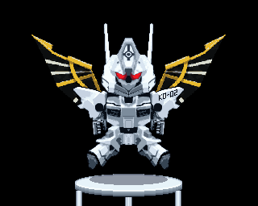 |
| ⑤ 通信切断 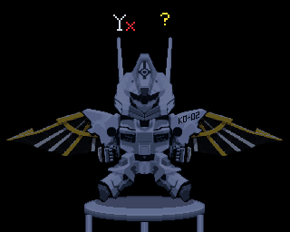 | 登場・退場  |

## ファイル

```
dist/koudaioh.html      1 ファイル版・羽なし（生成物。web/ の HTML と .js をまとめたもの）
dist/koudaioh_wings.html  1 ファイル版・羽付き（生成物）
web/index.html          プレーヤー（操作パネル、キー操作、URL パラメータ、WebSocket）
web/koudaioh_anim.js    アニメーション本体。DOM 非依存（ブラウザでも Node でも同じ絵が出る）
web/player.js           一定 fps で回して canvas に整数倍表示する
web/sprite_data.js      スプライト（生成物。文字グリッドなので手でドット修正してもよい）
web/sprite_wings.js     羽 5 コマ（生成物）。本体と椅子は sprite_data.js を共有する
tools/build_sprite.py   元画像 → sprite_data.js
tools/build_wings.py    羽のシート → sprite_wings.js
tools/build_standalone.js  web/ → dist/koudaioh.html, dist/koudaioh_wings.html
tools/render_frames.js  ブラウザなしでフレームを書き出す
tools/export_gif.py     プレビュー GIF とコマ一覧を作る
assets/source/          元画像（KO-02 入り点灯版 / 旧点灯版 / 消灯版 / 羽のシート）
test/anim.test.js       状態遷移・左右対称・目の光漏れなしなどのテスト
```

## スプライトの作り方

```
npm run build                      # sprite_data.js → sprite_wings.js → dist/ の順に作り直す（Pillow, numpy が必要）
npm run preview                    # docs/preview/ を作り直す
npm test                           # web/ を変えたのに dist/ を作り直していないと失敗する
```

`build_sprite.py` の処理:

1. 元画像（`koudaioh_ko02.png`。元の 765×1024 の絵を 1.417 倍にして右肩に KO-02 を足したもの）を 765×1024 に戻し、4px 格子のドット絵なので 4×4 ブロックの中央値で 192×256 に取り込む（= 元絵の実解像度）
2. 外周とつながった黒を背景として除去。元画像の椅子は靴と重なっているので行・列・明るさで切り離し、椅子は楕円で描き直す（本体が離れても欠けないように）
3. 顔は消灯版（`koudaioh_eyes_off.jpg`）の画素を使う。目は「点灯版で赤く、消灯版で暗い（バイザーの中の）画素」を赤みで 4 段階に分けたもの。目の外の装甲への照り返しは含めない
4. 左右対称化: 向かって左半分を右へ鏡映する。軸は列 87（元絵は輪郭の軸が列 88、額マークなど内側の模様が列 87 とずれているので、顔の模様を優先）。その後キャンバス中央（列 95）へ寄せる
5. k-means で 10 階調に減色、1px アウトライン
6. 右肩に KO-02 を描く。対称化の後に描くので鏡映されない（左右対称の唯一の例外。範囲は `anchors.decal`）。
   元絵の文字は 1 文字 4×7px で、取り込むと潰れて読めないので、同じ角張った字形で打ち直して右上がりに傾けている

`build_wings.py` の処理:

1. シートの各コマのロボットを羽なし版の本体に位置合わせする（縮尺と位置。本体の画素だけを使ったマスク付き正規化相互相関を、numpy の FFT で縮尺を振って求める。シート 1.67px = 本体 1px）
2. 本体と同じ縮尺に取り込み、本体と椅子の外にある前景（輝度 8 以上。羽の黒い膜は 11〜20、背景は 0〜4）を羽とする。金を含まない破片（アンテナや輪郭のずれ）は捨てる
3. 向かって左の羽を右へ鏡映し、7 色に減色

`sprite_data.js` の文字の意味:

| 文字 | 意味 |
|---|---|
| `.` | 透明 |
| `0`〜`9` | グレー（暗 → 明） |
| `o` | アウトライン |
| `F` `E` `D` `d` | 目（芯 / 明赤 / 赤 / 暗赤）。状態ごとの色に置き換わる |
| `m` | 額のセンサーマーク。通常は `palette.m` の色、自動運転で青 / 緑に点滅 |
